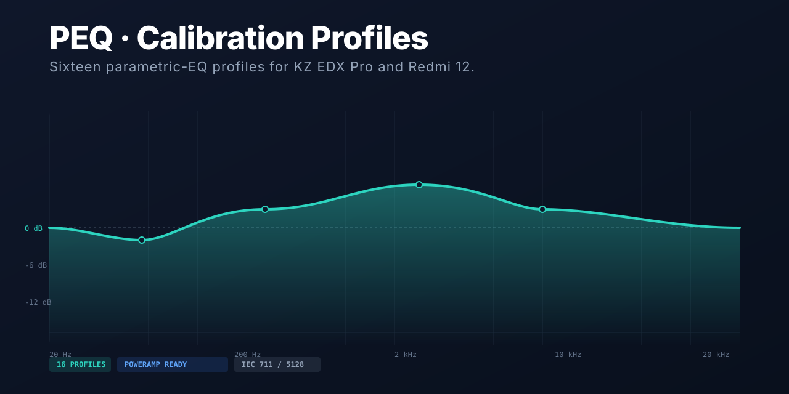

<div align="center">



# PEQ · Calibration Profiles

**Measured, not guessed.**  
Sixteen parametric-EQ profiles for the KZ EDX Pro (IEC 711 and B&K 5128) and the Redmi 12 speaker.

[](https://nmstudioo.github.io/peq_edx_r12/)


[Overview](#overview) · [Features](#features) · [Profiles](#profiles) · [Design](#design-system) · [Structure](#repository-structure)

</div>

---

## Overview

This is a static portfolio site for measured parametric-EQ profiles. Each profile is a set of biquad filters that can be copied directly into Poweramp. The site previews the predicted response—the measured frequency response plus the summed 48 kHz biquads—so you can see exactly what the correction does before you import it.

> [!WARNING]
> Curves are predictions, not re-measurements. Raw responses are normalized to 0 dB at 1 kHz. The pack contained no target-curve data, so none is drawn interactively.

| Attribute | Value |
|:--|:--|
| **Profiles** | 16 |
| **Devices** | KZ EDX Pro, Redmi 12 |
| **Export** | Poweramp `Preamp / Filter` text |
| **Build step** | None (pre-generated data) |

---

## Features

- **Preview:** Each profile's predicted response is rendered as a chart.
- **Compare mode:** Overlay multiple profiles to see how they differ.
- **Export:** Copy or download Poweramp-ready text with one click.
- **No tracking, no dependencies:** Pure static HTML, CSS, and JavaScript.

---

## Profiles

| Device | Measurement | Count |
|:--|:--|:--|
| KZ EDX Pro | IEC 711 | 8 |
| KZ EDX Pro | B&K 5128 | 4 |
| Redmi 12 | Speaker | 4 |

---

## Design System — "Measurement Lab"

Clinical teal and slate gray on clean white or dark charcoal backgrounds. The interface prioritizes data density, legibility, and precise charting without unnecessary decoration.

| Role | Face |
|:--|:--|
| Display | **Inter Tight** |
| Body | **Inter** |
| Data | **JetBrains Mono** |

| Token | Light | Dark | Use |
|:--|:--|:--|:--|
| `--bg` | `#ffffff` | `#0f172a` | Page background |
| `--teal` | `#0d9488` | `#2dd4bf` | Accents, active states |
| `--mut` | `#64748b` | `#94a3b8` | Muted text |

---

## Repository Structure

```text
peq_edx_r12/
├── index.html
├── assets/
│   ├── style.css       ← design tokens + components
│   ├── app.js          ← DSP, charts, UI
│   ├── data.js         ← generated by scripts/build_data.py
│   └── img/*.webp      ← reference graphs
├── profiles/*.txt      ← importable presets
└── scripts/
    └── build_data.py   ← regenerates data from the source pack
```

---

<div align="center">
<sub>Designed &amp; tuned by <b>Noushad M.</b> · © 2026</sub>
</div>
